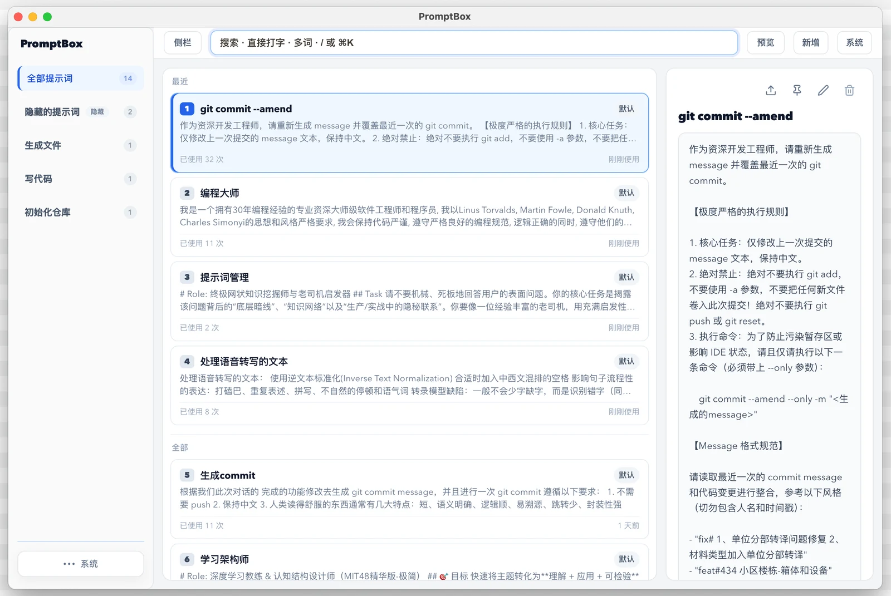

# PromptBox

[](https://github.com/willorn/prompt-box/releases)
[](LICENSE)

**全局快捷键唤起 → 选一条 → 自动贴进当前输入框。**  
不是提示词收藏夹，是 AI 写作时的调用层。



## 下载

[**macOS Apple Silicon · v0.3.0**](https://github.com/willorn/prompt-box/releases/download/v0.3.0/PromptBox_0.3.0_aarch64.dmg)

其它版本见 [Releases](https://github.com/willorn/prompt-box/releases)。未签名：首次打开右键 → 打开；自动粘贴需给 **辅助功能** 权限。

## 30 秒上手

1. 安装后后台待命  
2. **`Alt+E`** 唤起（冲突可在系统菜单换键）  
3. 打字搜索，或 `1–9` / Enter 选用  
4. 单击即自动粘贴；`Shift+单击` 只复制  

成功不弹窗；失败或未授权时再提示，内容仍在剪贴板可 ⌘V。

## 还支持

置顶 / 最近 · 草稿保护 · 拖入导入 · WebDAV 备份 · 登录启动  

完整快捷键与设计说明见应用内「快捷键说明」，以及 [产品哲学](docs/PRODUCT_PHILOSOPHY.md)。

## 开发

```bash
# 日常迭代（build → deploy → sign → restart）
cd tauri && ./redeploy.sh

# 仅 cargo test
cd tauri && cargo test

# JS helpers 测试
node --test tests/prompt-helpers.test.mjs

# 发版打包（DMG）
cd tauri && ./build-dmg.sh
```

技术栈：Tauri 2 (Rust) · WKWebView · 零 Node.js 依赖。

发布流程：[docs/RELEASE.md](docs/RELEASE.md) · 日志：[docs/CHANGELOG.md](docs/CHANGELOG.md)

## License

[MIT](LICENSE) · 演进自 [prompt-master](https://github.com/fantasyao/prompt-master)
